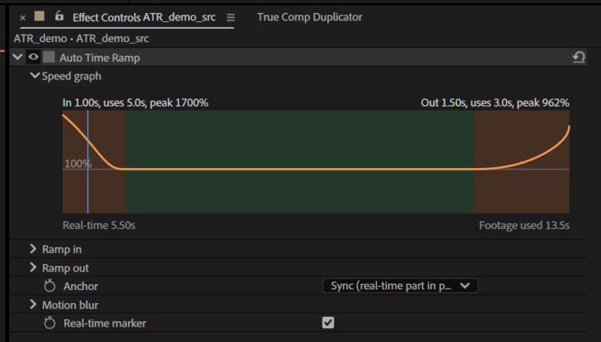
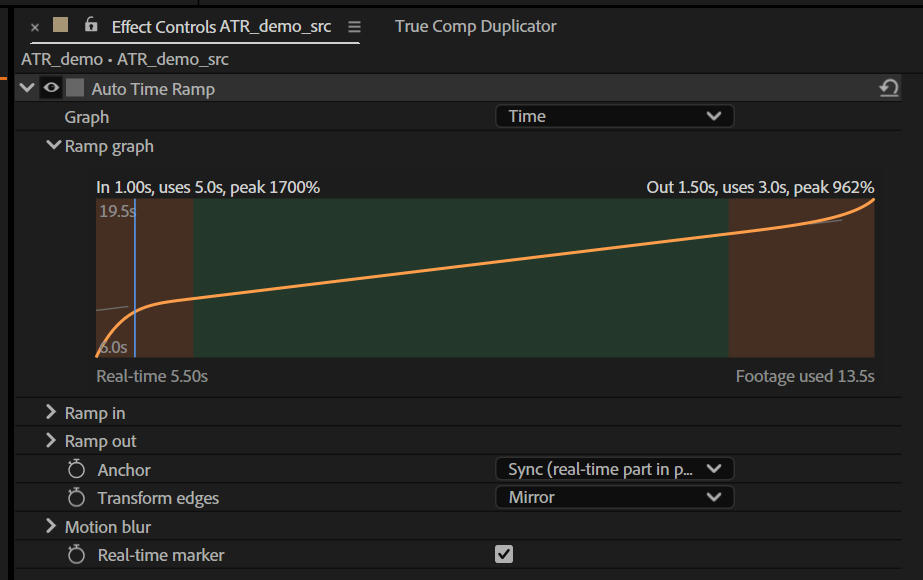

# Auto Time Ramp

After Effects effect (native C++, AE SDK) that speed-ramps a layer into and out of real-time at its
in/out points. No Time Remap, no keyframes: everything is derived from the layer's trimmed length.
Design: [docs/DESIGN.md](docs/DESIGN.md).

Status: **v0.5.1**: ramps, ease presets incl. Custom bezier, linked ramp out, anchors, speed-based
motion blur, ramp-linked transform (scale/rotation/position/opacity) with mirror edges, a Speed/Time
graph in Effect Controls, and a text-free real-time marker on the layer.

## Layout

| Path | What |
|---|---|
| `src/core/RampMath.*` | Pure C++ ramp math (no SDK). Speed curves, peak solve, source-time mapping. |
| `src/effect/AutoTimeRamp.*` | SmartFX effect: params, UI updates, render; PiPL resource. |
| `src/effect/Settings.*` | Reads params (render, UI, AEGP streams) and layer timing. |
| `src/effect/Graph.*` | Speed graph drawn in Effect Controls (Drawbot). |
| `src/effect/Marker.*` | Real-time marker sync + idle hook that follows trims. |
| `tests/test_rampmath.cpp` | Standalone unit tests for the math. |
| `win/AutoTimeRamp.vcxproj` | VS2022 (v143) project. |
| `build.ps1` | Build helper. |

## Build (Windows)

Needs Visual Studio 2022 with the C++ desktop workload and the AE SDK (not in this repo).

1. Copy `win\local.props.example` to `win\local.props` and set `AE_SDK` to the SDK folder
   (the one containing `Examples\Headers`).
2. Build:

```powershell
.\build.ps1            # Release .aex -> build\Release\AutoTimeRamp.aex
.\build.ps1 -Tests     # RampMath unit tests
.\build.ps1 -Config Debug
```

## Install for development

AE's plug-in folder needs admin rights. Once, from an **admin** PowerShell, link the build folder into AE:

```powershell
New-Item -ItemType Junction -Path "C:\Program Files\Adobe\Adobe After Effects 2026\Support Files\Plug-ins\AutoTimeRamp" -Target "<repo>\build\Release"
```

After that every build is picked up on the next AE launch. Close AE before rebuilding: AE locks the `.aex`.

The effect appears under **Effect > Time > Auto Time Ramp**.

## Effect controls

| Speed | Time |
|---|---|
|  |  |

- **Graph**: switches the graph between **Speed** and **Time**.
  - *Time* shows the source time at each moment of the layer (the curve a Time Remap graph would show),
    with a dashed 1:1 line for untouched playback and the source time range labelled.
  - *Speed* shows speed over the layer's length on a log scale, with the ramp zones (orange),
  real-time zone (green), 100% line and playhead. The header shows each ramp's duration, footage
  used and peak speed. The footer shows the real-time length and total footage used, or a red warning
  when a ramp runs off the clip or starts from a freeze.
- **Ramp in / Ramp out**
  - *Duration (s)*: timeline length of the ramp.
  - *Footage used (s)*: how much source the ramp runs through. More than the duration means a
    fast whoosh ramp (peak speed is solved automatically); less means a slow ramp, down to a freeze.
  - *Ease*: Snap, Soft snap, Hard snap, Whip, Expo snap, Circ snap, Settle, Smooth, Linear, Custom.
    *Custom* shows four bezier sliders (x1, y1, x2, y2, like CSS `cubic-bezier`); the curve is
    clamped to 0–1 so playback never runs backwards.
  - *Same as ramp in* (ramp out, on by default): mirrors the ramp-in settings; the ramp-out controls grey out.
  - *Motion direction* (ramp out, while linked): **Continue through the cut** (default) inverts the
    ramp-in motion, so the image keeps moving the same way, as in whip-pan or zoom transitions.
    **Mirror ramp in** plays it backwards.
  - *Transform at cut*: Scale (%), Rotation (deg), Position X/Y (px) and Opacity (%) at the cut.
    They ease back to 100% / 0 / 0 / 100% exactly as the speed settles: the weight is the ramp's own
    ease, `1 - e(u)`, the same curve as `(speed - 1) / (peak - 1)`. The transform is applied per
    motion-blur sample, so fast zooms, spins and slides blur along their motion.

  
- **Anchor**
  - *Sync*: the real-time part plays at its natural time. Pick the content by slip-editing
    (Alt-drag the layer content). The ramps use footage before and after it.
  - *Head*: starts on the in-point frame.
  - *Tail*: ends on the out-point frame.

- **Transform edges**: what fills the frame when the transform pulls the image's edges in:
  **Mirror** (default, seamless, like transition packs), **Transparent**, or **Repeat**.
- **Motion blur**
  - *Enable*: off by default.
  - *Shutter angle*: 180° = shutter open for half a frame, centred on the frame. Up to 720°.
  - *Max samples*: cap on source samples averaged per frame (1–64, default 16).

  Each frame averages source samples spread across the shutter, one per source frame the shutter
  sweeps past. Fast parts of a ramp get long streaks. In the real-time zone (and anything under about 2×
  speed at 180°) the shutter covers less than one source frame, so a single sample is used and the
  image is untouched.

- **Real-time marker** (on by default): a green duration marker on the layer, with no text, spanning
  the real-time zone. It is recognised by a hidden marker parameter (`AutoTimeRamp=real-time`);
  markers from v0.3/v0.4, which carried the comment "Real-time (Auto Time Ramp)", are rewritten without it. It follows param changes immediately (same
  undo step) and trims within about ¼ s (its own undo step, "Auto Time Ramp marker"). Undoing that step
  leaves the marker where it was; the next trim or param change syncs it again. Other markers are never
  touched. The marker is display only: dragging it doesn't change the ramps.

Real-time length = layer length − ramp in − ramp out. If the ramps don't fit, both shrink proportionally.

Render debug log: create `%TEMP%\AutoTimeRamp_debug.flag` and every PreRender/SmartRender appends its
rectangles to `%TEMP%\AutoTimeRamp_debug.log`; delete the flag to stop.

A crash guard wraps every entry point AE calls: a fault inside the plug-in is written to
`%TEMP%\AutoTimeRamp_crash.log` (step + code offset; look it up in `build\Release\AutoTimeRamp.map`) and
returned to AE as an error instead of crashing it.

Rebuilding while AE is open works: `build.ps1` moves the locked `.aex` aside. Restart AE to load it.

## Automated AE self-test

With After Effects 2026 running on an **empty project** (the script refuses to start AE itself;
`.uild.ps1 -RestartAE -AETest` restarts AE first if it holds only self-test items) (Preferences > Scripting & Expressions >
*Allow Scripts to Write Files and Access Network* enabled):

```powershell
.\build.ps1 -AETest
```

[tests/ae/selftest.jsx](tests/ae/selftest.jsx) builds a throwaway precomp whose red channel encodes its
own time, applies Auto Time Ramp, and reads the post-effect pixel back on every frame with
`sampleImage()`. [tests/ae/compare_selftest.cpp](tests/ae/compare_selftest.cpp) then checks every frame
against `RampMath`. It covers sync/head/tail anchors, in/out trims, Settle/Circ/Expo/Whip eases,
source clamping, Custom bezier, linked ramp out, motion blur (shutter angle and sample cap), and
32/16/8 bpc. Ramp-transform cases view a horizontal gradient through scale/rotation/position/opacity
with each edge mode and check every sampled point against the inverse transform. [tests/ae/marker_test.jsx](tests/ae/marker_test.jsx) then checks the real-time marker in
stages: created on apply (with no text, upgrading an old text marker), updated on param change, followed
after a trim, removed when switched off. The green channel is a
sine of time, so averaging shows up in it: blur cases must match the predicted shutter average and
visibly differ from an unblurred render. All test items are removed afterwards; the project is not saved.

## Manual test checklist

Use a precomp that shows its own time, e.g. a 60 s comp with a solid + the **Timecode** effect, placed
in a main comp and trimmed to 7 s with plenty of handle on both sides. Apply Auto Time Ramp with the
defaults (1 s / 5 s / Snap on both sides).

1. **Handles**: during the first second the timecode races through ~5 s of time and lands on
   natural speed. Black or frozen frames here mean reading frames outside the trim doesn't work.
2. **Render thread**: no error dialogs with Multi-Frame Rendering on (Preferences > Memory & Performance).
3. **Cache**: RAM-preview, then trim the out point. The ramp out must move with it, with no stale frames.
4. **Bit depth**: switch the project to 16 and 32 bpc; the image must stay correct.
5. **Footage**: repeat with a long video clip (5 min), trimmed to 7 s in the middle.
